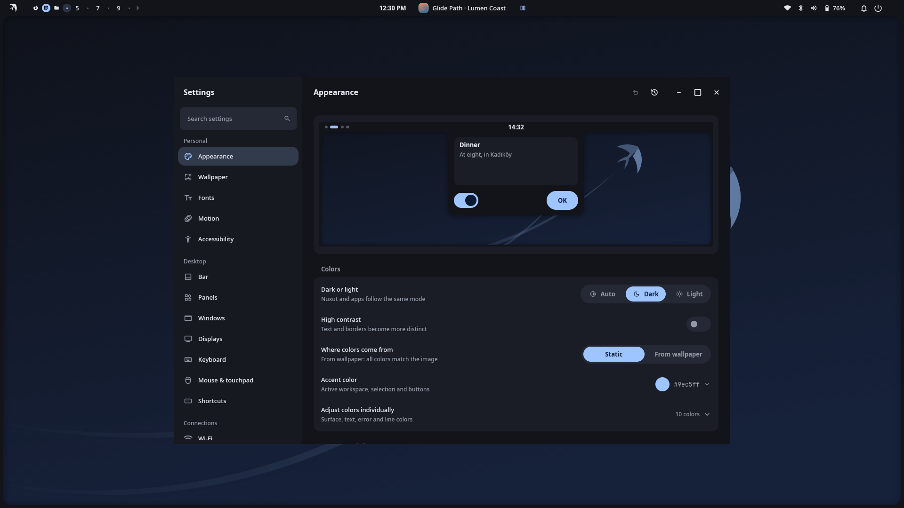
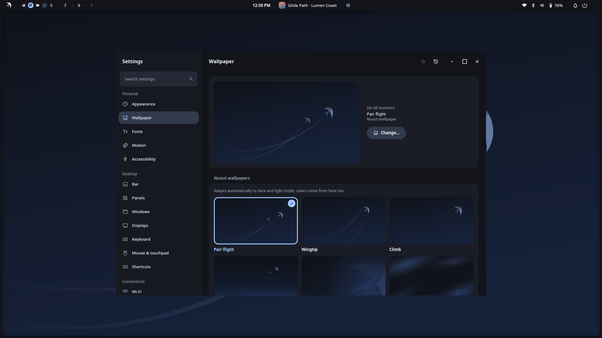

<p align="center">
  
</p>

<h1 align="center">Nuxut Settings</h1>

<p align="center"><em>The penguin can't fly. This one can.</em></p>

The settings app of the [Nuxut](https://github.com/nuxut/shell) desktop for Hyprland. Every change
applies instantly and can be undone; there is no "Apply" button.

<p align="center">
  
  
</p>

## Pages

Appearance and themes · wallpaper (per monitor, video wallpapers) · bar and panels · fonts ·
motion · displays · night light · sound · network (Wi-Fi, VPN, WireGuard) · Bluetooth · power ·
keyboard and shortcuts · input · date, time and region · default apps · notifications ·
printers · online accounts · user · accessibility · about.

## Install

Settings is installed together with the shell:

```sh
curl -fsSL https://raw.githubusercontent.com/nuxut/shell/main/install.sh | sh
```

To build on its own, clone the repositories side by side (path dependencies):

```sh
for r in framework shell settings calendar; do git clone https://github.com/nuxut/$r.git; done
cd settings && cargo build --release
```

Architecture: [docs/ARCHITECTURE.md](docs/ARCHITECTURE.md) (Turkish).

## Türkçe

Nuxut masaüstünün Ayarlar uygulaması. Her değişiklik anında uygulanır ve geri alınabilir.
Kabukla birlikte `install.sh` ile kurulur. Lisans: MIT.

## Contributing and security

See [CONTRIBUTING.md](CONTRIBUTING.md) and [SECURITY.md](SECURITY.md).

## License

[MIT](LICENSE) © 2026 Hakan Göksu
